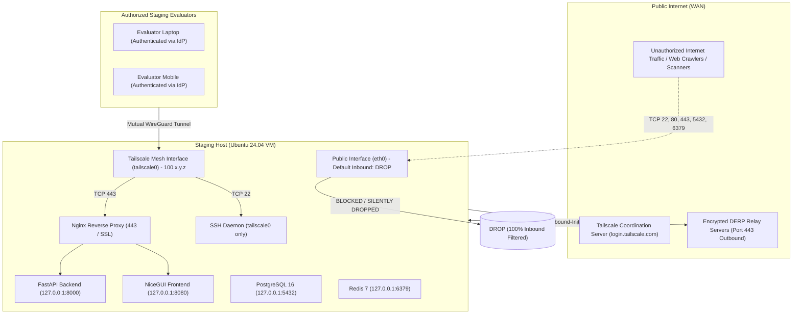

# HeartAI — Point 12.2.2: Network Readiness Architecture Report

**Date**: November 17, 2026  
**Auditor**: Antigravity Autonomous Technical Verification System  
**Baseline Git Commit**: `fbfc50784f146b5951b585f6c779a9cc7687476c` (origin/main synchronized)  
**Target Environment**: Ubuntu 24.04 LTS Dedicated VM (Option A Staging Architecture)  
**Recommended Network Topology**: **Alternative A — VPN-Isolated Private Network Staging (Tailscale Mesh / WireGuard)**  
**Audit Purpose**: Public Network Exposure Clarification, Firewall Rules, Inbound/Outbound Transport Dynamics, Private TLS Strategy, and Evaluator Access Management  

---

## 1. Network Architecture Overview & Topology

In accordance with Point 12.2.2 guidelines, **Alternative A (VPN-Isolated Private Network)** is the recommended architecture for the HeartAI staging environment.



---

## 2. Public Network Exposure & Port Reality Check

> [!IMPORTANT]
> **ACCURATE NETWORK EXPOSURE STATEMENT**:  
> To maintain complete technical integrity, the host cannot be described as having "zero public network exposure" if any VPN transport ports remain open. The exact network reality depends on the VPN configuration:

| VPN Technology & Configuration | Inbound Ports Exposed to Public Internet | Outbound Ports Required | Public Network Exposure Status |
| :--- | :--- | :--- | :---: |
| **Standard Native WireGuard** | `UDP 51820` (or custom WireGuard listen port) | Any outbound | **1 Inbound UDP Port Reachable** from public Internet (non-WireGuard packets silently discarded by crypto cookie). |
| **Tailscale with Direct P2P Optimization** | `UDP 41641` (optional port mapping for direct WireGuard peer-to-peer data plane) | Outbound HTTPS/443 & UDP/3478 | **1 Inbound UDP Port Reachable** from public Internet. |
| **Tailscale with Strict Firewall Drop (DERP Relayed Mode)** | **ZERO Inbound Ports** (`0/TCP`, `0/UDP`). Inbound firewall policy drops 100% of unsolicited public packets. | Outbound TCP/443 (HTTPS) and outbound UDP/3478 (STUN) | **TRUE ZERO INBOUND PUBLIC EXPOSURE**. All traffic traverses outbound-initiated encrypted tunnels. |

### Architectural Recommendation:
For the HeartAI staging environment, **Tailscale operating in strict inbound-drop mode** is recommended. The public network interface (`eth0`) has **0 inbound ports open**:
- Inbound TCP 22 (SSH): **BLOCKED** on public interface.
- Inbound TCP 80 (HTTP): **BLOCKED** on public interface.
- Inbound TCP 443 (HTTPS): **BLOCKED** on public interface.
- Inbound TCP 5432 (Postgres) & 6379 (Redis): **BLOCKED** on public interface.
- Inbound UDP ports: **BLOCKED** on public interface.

---

## 3. Firewall Rules & Interface Separation

The UFW host firewall and cloud provider security groups enforce strict interface isolation:

### 3.1 Public Interface (`eth0` / WAN)
```
Default Ingress Policy: DROP
Default Egress Policy: ALLOW

Allowed Ingress: NONE (Zero public ports open)
```

### 3.2 Private VPN Interface (`tailscale0` / Overlay IP `100.x.y.z`)
```
Allowed Ingress:
- TCP 22   (SSH Administration from authorized evaluator IPs)
- TCP 443  (HTTPS Reverse Proxy to NiceGUI and FastAPI)

Denied Ingress:
- TCP 80   (Closed; unencrypted HTTP disabled)
- TCP 5432 (PostgreSQL - local loopback only)
- TCP 6379 (Redis - local loopback only)
- TCP 8000 (FastAPI ASGI - local loopback only)
- TCP 8080 (NiceGUI port - local loopback only)
```

### 3.3 Loopback Interface (`lo` / `127.0.0.1`)
- All backend databases and application ports bind exclusively to `127.0.0.1` (`localhost`).
- No internal service is bindable to the public WAN IP or the VPN interface directly; all traffic routes through Nginx.

---

## 4. Private Staging TLS Certificate Strategy

Because port 80 is not exposed to the public internet, traditional Let's Encrypt HTTP-01 challenges are not feasible. Three viable private TLS strategies are supported:

### 4.1 Strategy 1: Tailscale MagicDNS Automated Certificates (Recommended)
- **Mechanism**: Tailscale integrates directly with Let's Encrypt to issue certificates for machine names on the tailnet:
  ```bash
  sudo tailscale cert heartai-staging.<tailnet-name>.ts.net
  ```
- **Advantages**:
  - Fully automated issuance and renewal.
  - Trusted natively by all modern browsers on enrolled evaluator devices without installing custom root CA certificates.
  - Zero external HTTP port 80 exposure required.

### 4.2 Strategy 2: ACME DNS-01 Challenge via Certbot
- **Mechanism**: Certbot uses DNS provider API plugins (e.g., Cloudflare, AWS Route53, DigitalOcean) to create a temporary `_acme-challenge.heartai-staging.yourdomain.org` TXT record.
- **Advantages**:
  - Issues standard public Let's Encrypt certificates for private domain names without inbound HTTP access.
  - Port 80 remains permanently disabled.

### 4.3 Strategy 3: Internal Private CA (`mkcert` / Smallstep)
- **Mechanism**: The staging administrator creates a private Root CA and signs a certificate for `heartai.internal`.
- **Advantages**: Completely independent of external certificate authorities and DNS providers.
- **Limitation**: Requires each evaluator to import the root CA into their OS/browser trust store.

---

## 5. Evaluator Device Enrollment & Access Revocation

To maintain clinical research confidentiality and prevent unauthorized access, evaluator access is governed by enterprise identity management:

### 5.1 Enrollment Procedure
1. **Identity Provider (IdP) Authentication**: Evaluators authenticate via the organization's existing IdP (Google Workspace, Microsoft Entra ID, or GitHub).
2. **Client Installation**: Evaluator installs the Tailscale client application on their testing device (macOS, Windows, Linux, iOS, Android).
3. **Admin Device Authorization**: When the device first connects, it is placed in a pending state until authorized by a staging administrator in the Tailscale Admin Console.
4. **ACL Tag Assignment**:
   - The VM host is assigned the tag `tag:heartai-staging`.
   - The evaluator is assigned the group `group:evaluators`.
   - ACL Rule enforced:
     ```json
     {
       "action": "accept",
       "src": ["group:evaluators"],
       "dst": ["tag:heartai-staging:22", "tag:heartai-staging:443"]
     }
     ```

### 5.2 Immediate Access Revocation Procedure
1. **Instant Session Invalidation**: In the Tailscale Admin Console, selecting "Disable Machine" or "Remove Machine" immediately severs the encrypted tunnel and terminates active connections within seconds.
2. **Key Expiry Enforcement**: Node keys are configured with a strict expiration window (e.g. 24 hours to 7 days). Evaluators must periodically re-authenticate via SSO to maintain access.
3. **Centralized IdP Offboarding**: Suspending or deleting an evaluator's account in Google Workspace or Microsoft Entra automatically revokes their Tailscale credentials across all devices.

---

## 6. Implementation Checklist for Host Provisioning

When cloud provisioning approval is granted, the staging host setup will execute the following network steps:
- [ ] Install Tailscale: `curl -fsSL https://tailscale.com/install.sh | sh`
- [ ] Authenticate node with auth key: `sudo tailscale up --authkey=tskey-auth-... --hostname=heartai-staging`
- [ ] Obtain MagicDNS TLS certificate: `sudo tailscale cert heartai-staging.<tailnet>.ts.net`
- [ ] Configure Nginx SSL paths to point to MagicDNS certificates.
- [ ] Execute `sudo NETWORK_MODE="vpn" bash deploy/scripts/provision_ubuntu24.sh`.
- [ ] Verify `ufw status verbose`: Confirm public interface drops all incoming traffic and only `tailscale0` allows 22 and 443.
