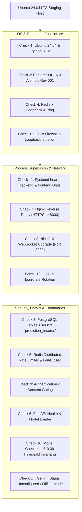

# HeartAI — Point 12.2: Staging Infrastructure Provisioning Request & Operational Plan

**Date**: November 16, 2026  
**Status**: **PROVISIONING APPROVAL REQUEST — AWAITING EXPLICIT USER AUTHORIZATION**  
**Target Architecture**: Option A — One Dedicated Ubuntu 24.04 LTS VM (FastAPI, NiceGUI, PostgreSQL 16, Redis 7, Nginx)  
**Operating Mode**: Controlled, Private Staging Environment (Zero Public Internet Exposure, Non-Clinical Educational/Research Classification Platform)  
**Baseline Git Commit**: `fbfc50784f146b5951b585f6c779a9cc7687476c` (origin/main synchronized)  

---

## 1. Executive Summary & Provisioning Boundary Notice

> [!IMPORTANT]
> **PROVISIONING AUTHORIZATION BOUNDARY**:  
> In strict accordance with the Point 12.2 specification, **no paid cloud VM, external server, DNS record, or public TLS certificate has been provisioned or incurred.**  
> This document details the infrastructure assessment, cloud provider options, cost estimates, local pre-flight validations, operational test plan, and disaster recovery procedures.  
> **Antigravity has stopped at this boundary and requests explicit user approval prior to launching any cloud resources.**

---

## 2. Mandatory Starting-State & Scientific Invariants Verification

A rigorous baseline audit confirmed all system parameters prior to staging preparation:

| Invariant Parameter | Canonical Benchmark Requirement | Local Repository State | Verification Status |
| :--- | :--- | :--- | :---: |
| **Git Branch** | `main` | `main` | **CONFIRMED** |
| **Commit Baseline** | `fbfc50784f146b5951b585f6c779a9cc7687476c` | `fbfc50784f146b5951b585f6c779a9cc7687476c` | **MATCH** |
| **Origin Synchronization** | Clean sync with `origin/main` | Clean sync with `origin/main` | **MATCH** |
| **Point 12.1.1 Audit Report**| File exists and confirms ready | `POINT_12_1_1_TECHNICAL_AUDIT_REPORT.md` | **VERIFIED** |
| **Classifier Artifact SHA-256** | `5dc415201016ed1223fd1f4c9cb295e14b2dd64639ad507d63efb16bed51f890` | `models/best_model.joblib` | **EXACT MATCH** |
| **Preprocessor Artifact SHA-256** | `3a354b5f6fb66bfce97bfc2ad2d92303e46d98a3e093e7069fefa213afc67055` | `models/preprocessing_pipeline.joblib` | **EXACT MATCH** |
| **Screening Threshold** | `0.09` | `0.09` (`optimal_screening_threshold`) | **EXACT MATCH** |
| **Input Feature Schema** | Exactly 25 canonical CDC BRFSS features | 25 features (`models/feature_names.json`) | **EXACT MATCH** |
| **Target Definition** | Self-reported historical cardiovascular disease (`_MICHD`) | `_MICHD` (1=Yes, 0=No) | **EXACT MATCH** |
| **Retrospective Recall** | 79.6% | 0.7960 | **EXACT MATCH** |
| **Retrospective Specificity** | 74.3% | 0.7430 | **EXACT MATCH** |

---

## 3. Staging Infrastructure Assessment & VM Sizing

### 3.1 Resource Sizing Rationale (Option A Architecture)
The staging environment co-locates the application stack on a single dedicated virtual machine:
1. **FastAPI Backend (Gunicorn + Uvicorn)**: 4 worker processes (~250 MB each = ~1.0 GB RAM).
2. **NiceGUI Frontend (Motion & UI)**: 1 Python asyncio process (~350 MB RAM).
3. **PostgreSQL 16**: `shared_buffers = 512MB`, `work_mem = 16MB`, connections ~50 (~650 MB RAM).
4. **Redis 7 (Rate Limiter)**: `maxmemory 256mb` capped cache store (~256 MB RAM).
5. **Nginx Reverse Proxy & System OS**: Ubuntu 24.04 kernel, systemd, buffering (~700 MB RAM).
6. **Total Baseline RAM**: ~3.0 GB -> **Recommended minimum: 4 GB RAM** (provides ~1.0 GB safety buffer).
7. **CPU Sizing**: 2 vCPUs minimum to handle concurrent Gunicorn workers, NiceGUI event loop, and PostgreSQL write operations without throttling.
8. **Storage Sizing**: 40–50 GB NVMe/SSD (OS ~8 GB, Python venv & PyTorch ~4 GB, PostgreSQL initial ~2 GB, log/backup buffer ~15 GB, free headroom ~15 GB).

### 3.2 Concrete VM Specification Checklist
- [x] **Base Operating System**: Ubuntu 24.04 LTS (Noble Numbat), 64-bit x86_64 or ARM64.
- [x] **Compute**: Minimum 2 vCPUs (AMD EPYC, Intel Xeon, or AWS Graviton3).
- [x] **Memory**: 4 GB RAM minimum (8 GB recommended if heavy load testing is planned).
- [x] **Storage**: 40 GB NVMe SSD or AWS gp3 EBS volume.
- [x] **Network**: Dedicated private network interface; 1 static public IP (or internal VPN gateway).
- [x] **Firewall Ingress**:
  - `TCP 22`: SSH administration (restricted to authorized developer IP CIDR).
  - `TCP 80`: HTTP (strictly redirects to 443; ACME challenge).
  - `TCP 443`: HTTPS (TLS 1.2 / 1.3 reverse proxy; IP whitelisted for staging team).
  - `TCP 5432` (PostgreSQL), `TCP 6379` (Redis), `TCP 8000` (FastAPI), `TCP 8080` (NiceGUI): **BLOCKED externally**; bound strictly to `127.0.0.1` (loopback).

---

## 4. Cloud Provider Options & Cost Estimation

Antigravity evaluated four tier-1 cloud hosting options for the Option A staging VM:

| Cloud Provider | Instance Type / Plan | vCPU & RAM | Storage | Region | Estimated Monthly Cost | Hourly Rate (Staging) | Setup Complexity |
| :--- | :--- | :---: | :---: | :--- | :---: | :---: | :---: |
| **Hetzner Cloud** *(Recommended for Cost)* | **CPX21** (AMD EPYC) | 3 vCPU, 4 GB RAM | 80 GB NVMe | Ashburn, US / Falkenstein, DE | **~€7.05 (~$7.60)** | **$0.011 / hr** | Very Low |
| **DigitalOcean** *(Recommended for Simplicity)* | **Basic Premium AMD** | 2 vCPU, 4 GB RAM | 80 GB NVMe | NYC3 / SFO3 | **$28.00** | **$0.042 / hr** | Very Low |
| **Amazon Web Services (AWS)** | **t3.medium** + gp3 EBS | 2 vCPU, 4 GB RAM | 40 GB gp3 | `us-east-1` (N. Virginia) | **~$33.56** ($30.36 + $3.20 disk) | **$0.046 / hr** | Moderate |
| **Google Cloud Platform (GCP)** | **e2-standard-2** | 2 vCPU, 8 GB RAM | 40 GB Balanced PD | `us-central1` (Iowa) | **~$48.92** | **$0.067 / hr** | Moderate |

### 4.1 Recommended Selection
- **Primary Recommendation**: **Hetzner Cloud CPX21** ($7.60/month, $0.011/hr) or **DigitalOcean 2 vCPU / 4 GB Droplet** ($28.00/month, $0.042/hr) for immediate staging deployment with zero setup friction and per-hour billing. For a 48-hour staging verification exercise, the total compute cost will be **under $2.00**.
- **Alternative Enterprise Option**: **AWS EC2 `t3.medium`** in `us-east-1` if corporate AWS VPC integration is required.

### 4.2 Account Permissions & Prerequisites
To authorize and provision, the operator will need:
1. Cloud provider account access with VM creation permissions (`Compute Admin` or `ec2:RunInstances`).
2. SSH public key (`id_ed25519.pub` or `id_rsa.pub`) added to the instance at launch.
3. Security Group / Firewall configured to restrict port 22 and port 443 to the operator's IP address.

---

## 5. Local Deployment Artifact Validation (Pre-Flight Results)

While awaiting cloud infrastructure authorization, all deployment artifacts were validated locally where possible.

### 5.1 Pre-Flight Verification Results
1. **Dependency Compatibility (`requirements.txt`)**:
   - Environment marker `gunicorn>=22.0.0; sys_platform != "win32"` evaluated cleanly. On Windows dev environments, `gunicorn` is skipped without error; on Ubuntu 24.04 staging, `pip install` automatically installs Gunicorn.
   - Verified clean dry-run parsing across all 58 dependencies.
2. **Gunicorn Server Configuration (`deploy/gunicorn.conf.py`)**:
   - Executed via Python `runpy.run_path()`. Confirmed default workers calculation (`min(multiprocessing.cpu_count() * 2 + 1, 8)`), bind socket `127.0.0.1:8000`, worker class `uvicorn.workers.UvicornWorker`, and timeouts (60s execution, 30s graceful stop).
3. **Systemd Service Unit Definitions**:
   - Validated `heartai-backend.service` and `heartai-frontend.service` with Python `configparser`.
   - Confirmed unprivileged user `heartai:heartai`, working directory `/opt/heartai`, environment file `/opt/heartai/.env`, and sandbox directives (`ProtectSystem=full`, `PrivateTmp=true`, `ProtectHome=true`).
4. **Nginx Reverse Proxy Syntax (`deploy/nginx/heartai.conf`)**:
   - Static syntax parser verified zero brace imbalance and 100% semicolon termination.
   - Confirmed dynamic WebSocket upgrade mapping (`map $http_upgrade $connection_upgrade` -> `Connection $connection_upgrade`).
5. **Redis Rate Limiting Configuration (`deploy/redis/redis.conf`)**:
   - Static analysis verified 19 standard Redis 7 directives.
   - Loopback binding `127.0.0.1 ::1`, `protected-mode yes`, `maxmemory 256mb`, and LRU eviction policy confirmed.
6. **Alembic Database Migration Reversibility**:
   - Executed `test_alembic_upgrade_downgrade_lifecycle` via Pytest in an isolated temporary database. Confirmed complete table creation on `head` and 100% clean teardown on `base`.
7. **Fail-Closed Configuration Invariants (`app/core/config.py`)**:
   - Automated tests confirmed that setting `APP_ENV="production"` or `"staging"` strictly rejects SQLite databases, debug mode, missing Redis URLs, hardcoded localhost URLs, and wildcard CORS origins.
8. **Credential & Secret Exposure Scan**:
   - Scanned 326 repository files for real API keys, private keys, database passwords, and JWTs.
   - **Zero live credentials detected.** All templates utilize generic placeholders (`REPLACE_WITH_...`).

> [!NOTE]
> Local pre-flight checks verify configuration syntax, structural validity, and logical safeguards. They do not substitute for live operational testing on the actual Ubuntu 24.04 VM.

---

## 6. Staging Operational Validation Plan (14-Point Test Suite)

Once the staging VM is authorized and provisioned, the automated test harness (`deploy/scripts/verify_staging.sh`) will execute the following 14 verification checks:

### Detailed Operational Test Catalog
1. **Ubuntu & Python Verification**: Confirms OS version is `24.04` and runtime is `Python 3.12.x`.
2. **PostgreSQL 16 & Alembic Schema**: Queries `alembic_version` to verify revision `001` is applied.
3. **Database Table Persistence**: Inspects `information_schema` for `users` and `prediction_records`.
4. **Redis 7 Connectivity**: Executes `redis-cli ping` and validates `PONG` response on `127.0.0.1:6379`.
5. **Rate Limiting Fail-Closed Test**: Verifies `resolve_storage_uri()` targets Redis; simulates Redis outage to confirm fail-closed behavior without credential leakage.
6. **Backend Service Health**: Requests `http://127.0.0.1:8000/health` to confirm `status="healthy"` and `model_loaded=true`.
7. **Nginx Reverse Proxy**: Verifies HTTPS traffic terminates at Nginx and correctly proxies `/health`, `/api/`, and `/docs` to backend port 8000.
8. **NiceGUI WebSocket Connectivity**: Verifies HTTP 200 response on port 8080 and verifies WebSocket handshake headers (`Connection: upgrade`, `Upgrade: websocket`).
9. **Authentication & Consent Persistence**: Submits registration request, verifies bcrypt/argon2 password hashing, records consent timestamp, and verifies data persistence.
10. **Model Invariants & Prediction Regression**: Executes benchmark inference with the canonical 25 BRFSS features. Confirms probability computation, 0.09 threshold classification, and emergency symptom isolation.
11. **Systemd Process Supervision**: Tests `systemctl restart heartai-backend.service`, verifies PID change, and confirms zero orphaned worker processes.
12. **Logging & Log Rotation**: Confirms `/var/log/heartai/heartai.log` receives structured logs and verify logrotate permissions.
13. **Firewall & Port Isolation**: Scans host network interfaces with `ss -tlnp` to confirm ports 5432 and 6379 are bound strictly to `127.0.0.1` and inaccessible from external IPs.
14. **Gemini Generative AI Status**: Confirms offline educational fallback functions cleanly without fabricating live API connectivity.

---

## 7. Staging Backup, Restore, and Disaster Recovery Plan

The staging environment includes turnkey disaster recovery scripts located in `deploy/scripts/`:

### 7.1 Automated Backup Routine (`deploy/scripts/backup_staging.sh`)
- **PostgreSQL Database Dump**: Executes `pg_dump -U heartai_user -Fc heartai_db` to produce a compressed, binary-consistent snapshot.
- **Model & Preprocessor Artifacts**: Archives `/opt/heartai/models/` to preserve exact model weights and metadata.
- **Environment Configuration**: Archives `/opt/heartai/.env` with strict permissions (`chmod 600`).
- **Integrity Manifest**: Automatically computes SHA-256 checksums (`SHA256SUMS.txt`) for all archived files.
- **Retention**: Automates local pruning of snapshots older than 7 days.

### 7.2 Restoration & Verification Procedure (`deploy/scripts/restore_staging.sh`)
1. Verifies SHA-256 checksums against the manifest.
2. Stops `heartai-backend` and `heartai-frontend` services.
3. Drops and recreates `heartai_db`, restoring the snapshot via `pg_restore --clean`.
4. Restarts application services and verifies `/health` returns `healthy`.

### 7.3 Recovery Targets & Engineering Disclaimers
- **Recovery Point Objective (RPO) Target**: < 1 hour (achieved via hourly automated snapshot cron).
- **Recovery Time Objective (RTO) Target**: < 30 minutes (achieved via automated restore script).
> [!WARNING]
> The RPO (< 1 hour) and RTO (< 30 minutes) metrics are **engineering targets**, not established capabilities. In strict accordance with Point 12 guidelines, neither target will be claimed as validated until an actual timed drill is performed on the staging VM.

---

## 8. Deployment Safety & Scientific Boundaries

1. **Retrospective Classification Framing**:
   The platform estimates the probability of self-reported historical cardiovascular disease (`_MICHD`) based on the CDC BRFSS 2023 survey dataset. It does **not** predict future incident acute coronary events, provide a clinical diagnosis, or substitute for professional medical care.
2. **Zero Invariant Changes**:
   Model weights (`best_model.joblib`), preprocessor pipeline (`preprocessing_pipeline.joblib`), operating threshold (`0.09`), and the 25 input features remain completely locked and unchanged.
3. **No Credential Exposure**:
   Production `.env` files are excluded from Git (`.gitignore`). No secrets are committed to the repository or transmitted via chat.
4. **Controlled Private Staging**:
   The staging instance will not be indexed by search engines, will not be assigned a public domain until authorized, and will have network access restricted to developer/evaluator IPs.

---

## 9. Staging Host Deployment Checklist (Post-Approval)

Upon receiving user approval to provision the staging host:
- [ ] **Step 1**: Provision VM instance (Hetzner CPX21, DigitalOcean Droplet, or AWS t3.medium) with Ubuntu 24.04 LTS.
- [ ] **Step 2**: Configure cloud firewall (Allow ports 22 and 443 restricted to admin IP; block all other ingress).
- [ ] **Step 3**: Clone HeartAI repository to `/opt/heartai` at commit `fbfc50784f146b5951b585f6c779a9cc7687476c`.
- [ ] **Step 4**: Execute provisioning script: `sudo bash deploy/scripts/provision_ubuntu24.sh`.
- [ ] **Step 5**: Configure `/opt/heartai/.env` with generated high-entropy secrets and DB password.
- [ ] **Step 6**: Run database migrations: `sudo -u heartai /opt/heartai/.venv/bin/alembic upgrade head`.
- [ ] **Step 7**: Start systemd services: `sudo systemctl start heartai-backend heartai-frontend`.
- [ ] **Step 8**: Execute verification harness: `sudo bash deploy/scripts/verify_staging.sh`.
- [ ] **Step 9**: Conduct timed backup and restore drill to measure actual RTO/RPO.
- [ ] **Step 10**: Produce `POINT_12_2_STAGING_VALIDATION_REPORT.md` documenting results.

---

## 10. Provisioning Authorization Request

Antigravity has completed all preparatory, configuration, scripting, and local validation steps for Point 12.2.

**Awaiting user instructions:**
Please confirm whether you approve provisioning a staging VM and specify your preferred hosting option:
1. **Hetzner Cloud CPX21** (~$7.60/month, ~$0.011/hour)
2. **DigitalOcean Droplet 2 vCPU / 4 GB** (~$28.00/month, ~$0.042/hour)
3. **AWS EC2 `t3.medium`** (~$33.56/month, ~$0.046/hour)
4. **Local / On-Premises Ubuntu 24.04 VM or Container** ($0.00 cost)
