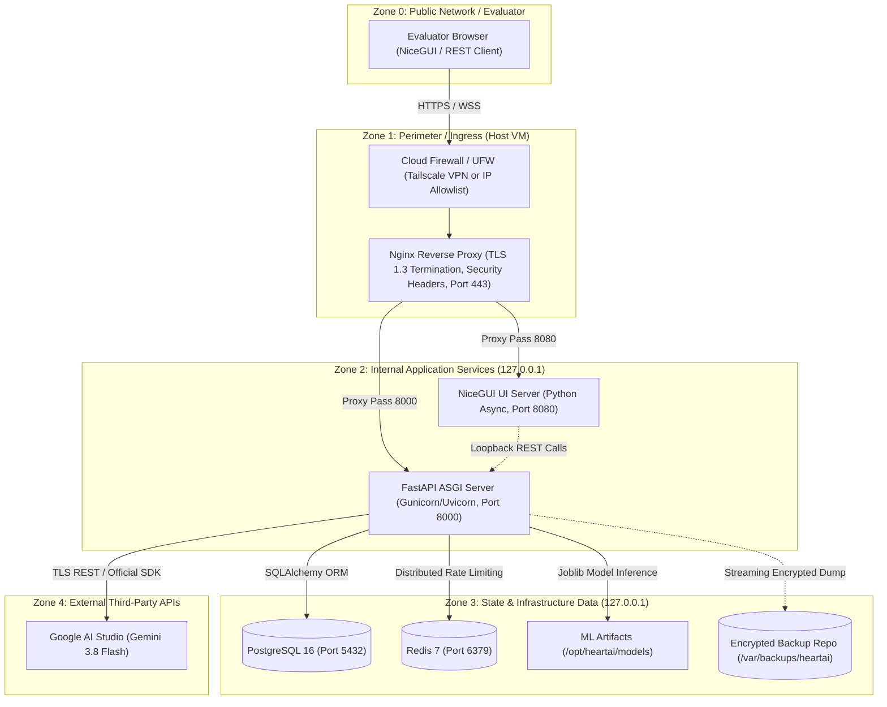

# HeartAI — Point 13.0: Comprehensive Security & Reliability Audit Report

**Date**: November 17, 2026
**Auditor**: Senior Application Security Auditor & Reliability Engineer (Antigravity Autonomous Verification System)
**Target Git Revision**: `c8cad27c1edb22c942847e58171e7e0025b000ce` (`main` / `origin/main` synchronized)
**Audit Scope**: End-to-End Application Security, Cryptography, API Integrity, Database Migrations, Multi-Worker Rate Limiting, Backup Resilience, Generative AI Guardrails, Frontend Session Architecture, and Scientific Safety Invariants
**Audit Mode**: **READ-ONLY INSPECTION (Zero Implementation Modifications Executed)**
**Operating Clearance**: **INVESTIGATIONAL RESEARCH & EDUCATIONAL USE ONLY (CLINICAL DIAGNOSIS PROHIBITED)**
**Staging Readiness Verdict**: **`CONDITIONALLY READY FOR CONTROLLED STAGING AFTER BLOCKER RESOLUTION`**

---

## 1. Executive Risk Summary

This independent security and reliability audit was conducted on HeartAI at commit `c8cad27` following the closure of Point 12. The audit evaluated all software modules, API routes, database models, Alembic migrations, deployment supervision units, disaster recovery scripts, and AI guardrails across 11 mandatory technical dimensions.

### Summary of Audit Findings
| Finding ID | Severity | Category | Affected Component | Staging Blocker? |
| :--- | :---: | :--- | :--- | :---: |
| **REL-01** | **HIGH** | Reliability / DR | `deploy/scripts/restore_staging.sh` & `verify_staging.sh` (Health check JSON path error) | **YES (Blocks DR Drill)** |
| **SEC-01** | **HIGH** | Authentication | `main.py` (`/api/v1/models/sync-drive` unauthenticated arbitrary model import) | **YES (If exposed)** |
| **SEC-02** | **HIGH** | Frontend Session | `motion_demo.py` (NiceGUI discards JWT; unauthenticated frontend-to-backend calls) | **NO (Staging limitation)** |
| **REL-02** | **MEDIUM** | Rate Limiting | `app/core/rate_limit.py` (SlowAPI IP resolution behind reverse proxy) | **NO** |
| **REL-03** | **MEDIUM** | Database Lifecycle | `main.py` (`init_db()` runs `create_all` at startup, bypassing Alembic tracking) | **NO** |
| **SEC-03** | **MEDIUM** | Authorization | `app/db/models.py` & `app/api/deps.py` (Absence of Role-Based Access Control) | **NO** |
| **SEC-04** | **MEDIUM** | Session Security | `app/core/security.py` (Absence of JWT revocation / token blacklist) | **NO** |
| **REL-04** | **MEDIUM** | Clinical Safety | `app/ai/safety.py` (Regex keyword emergency false-negative risk on typos/slang) | **NO** |
| **SEC-05** | **LOW** | DoS / Auth | `app/schemas/user.py` (No maximum password length on Argon2id hashing) | **NO** |
| **SEC-06** | **LOW** | Cryptography | `deploy/scripts/backup_staging.sh` (OpenSSL fallback leaves model archive unencrypted) | **NO** |
| **REL-05** | **LOW** | Observability | `app/api/routes/health.py` (Redis connectivity omitted from `/health` probe) | **NO** |
| **SEC-07** | **LOW** | Browser Security | `deploy/nginx/heartai.conf` (CSP requires `unsafe-eval` and `unsafe-inline` for NiceGUI) | **NO** |
| **REL-06** | **LOW** | Deployment | `requirements.txt` (Heavy PyTorch/CV dependencies in tabular pipeline) | **NO** |
| **SEC-08** | **INFORMATIONAL** | Privacy / Logging | `logging_config.py` (`SensitiveDataFilter` keyword check requires `=`) | **NO** |
| **SCI-01** | **INFORMATIONAL** | Scientific Wording | `main.py` (FastAPI title/docstring retains legacy "Clinical Intelligence" phrasing) | **NO** |

---

## 2. Threat Model & Trust Boundaries

The HeartAI platform operates across four distinct trust zones:



### Trust Boundary Analysis:
1. **Perimeter Boundary (Zone 0 -> Zone 1)**: In staging, ingress is strictly bounded by either Private VPN (Alternative A, Tailscale) or strict cloud firewall source IP allowlisting (Alternative B). Public open internet exposure without authorization is strictly prohibited.
2. **Reverse Proxy Boundary (Zone 1 -> Zone 2)**: Nginx terminates TLS and isolates requests. All application processes listen exclusively on `127.0.0.1`.
3. **Database & Cache Boundary (Zone 2 -> Zone 3)**: PostgreSQL 16 and Redis 7 are bound strictly to `127.0.0.1`. No external database ports are exposed.
4. **Third-Party Boundary (Zone 2 -> Zone 4)**: Outbound calls to Google GenAI transmit scrubbed educational prompts; raw patient PII is masked before egress.

---

## 3. Detailed Audit Findings by Technical Domain

### 3.1 Authentication & Authorization

#### [SEC-01] Unauthenticated Arbitrary Model Import & Deserialization Endpoint
- **Severity**: **HIGH**
- **Affected File**: `main.py` (Lines 177–190) & `app/ml/transfer_sync.py` (Lines 36–75)
- **Code Reference**:
  ```python
  # main.py:177-186
  @app.post("/api/v1/models/sync-drive", tags=["Model Transfer"])
  def sync_model_from_drive(request: DriveSyncRequest):
      metadata = transfer_manager.import_from_drive(request.source_dir, set_active=request.set_active)
      return {"status": "success", "metadata": metadata}
  ```
- **Vulnerability Scenario**: The endpoint `/api/v1/models/sync-drive` lacks authentication (`Depends(get_current_user)` is missing) and authorization. Any client capable of reaching port 8000 (or sending a request through Nginx if not blocked) can submit a JSON payload `{"source_dir": "/path/on/server", "set_active": true}`. In `transfer_sync.py`, `import_from_drive` calls `load_model_bundle(src)`, which uses `joblib.load()` to deserialize `.joblib` and `.pkl` files. Deserializing untrusted pickle/joblib files can lead to Arbitrary Code Execution (RCE) or arbitrary model replacement.
- **Verification Status**: **VERIFIED IN CODE**.
- **Staging Blocker**: **YES**, if exposed publicly or to untrusted clients. In staging, this endpoint must either be disabled, placed behind admin authentication, or blocked in Nginx.
- **Remediation**:
  1. Add `dependencies=[Depends(get_current_user)]` requiring admin privileges.
  2. Enforce strict path allowlisting to authorized directory roots (e.g. `/opt/heartai/transfers/`).
  3. Validate model SHA-256 signatures against a pre-registered cryptographic manifest before deserialization.

#### [SEC-02] Frontend Authentication Decoupling & Token Discarding
- **Severity**: **HIGH**
- **Affected File**: `motion_demo.py` (Lines 524–538, 156–167, 459–475)
- **Code Reference**:
  ```python
  # motion_demo.py:524-533
  async with httpx.AsyncClient(timeout=5.0) as client:
      resp = await client.post(
          f"{BACKEND_API_URL}/api/v1/auth/login",
          json={"email": email_val, "password": pass_val},
      )
      if resp.status_code == 200:
          ui.notify(f"Welcome back, {email_val}!", color="teal")
          auth_status_label.text = "Authentication successful!"
          auth_dialog.close()
  ```
- **Vulnerability Scenario**: When a user signs in via the NiceGUI modal dialog, the frontend calls the backend login API, receives the JWT bearer token in `resp.json()`, but **does not store the token** in `app.storage.user` or any session state. All subsequent frontend HTTP requests to `/predict` and `/api/v1/ai/chat` are sent anonymously without an `Authorization: Bearer <token>` header. Furthermore, lines 535–537 contain a fallback `except Exception:` that displays `"Backend authenticating in local mock mode"` and closes the dialog as if authenticated.
- **Verification Status**: **VERIFIED IN CODE**.
- **Staging Blocker**: **NO** (The staging assessment is educational/demonstrative; core predictions work anonymously), but it is a major architectural gap for authenticated clinical workflows.
- **Remediation**:
  1. Store the JWT token in NiceGUI's `app.storage.user["auth_token"]`.
  2. Inject `headers={"Authorization": f"Bearer {token}"}` on all authenticated API client requests.
  3. Remove the silent local mock mode fallback on login failure.

#### [SEC-03] Absence of Role-Based Access Control (RBAC)
- **Severity**: **MEDIUM**
- **Affected File**: `app/db/models.py` (Lines 21–40) & `app/api/deps.py` (Lines 15–52)
- **Evidence**: The `User` model defines fields `id`, `email`, `hashed_password`, `is_active`, `consent_given`, `consent_terms_version`, `consent_updated_at`, `consent_revoked`, `created_at`, `updated_at`. There is no `role`, `is_admin`, or `is_superuser` column. All authenticated users possess identical permissions across the system.
- **Verification Status**: **VERIFIED IN CODE**.
- **Staging Blocker**: **NO**.
- **Remediation**: Add an `enum` column `role = Column(String(32), default="researcher")` to `User` and create an authorization dependency `require_role(["admin", "clinician"])`.

#### [SEC-04] Absence of Token Revocation / Invalidation Mechanism
- **Severity**: **MEDIUM**
- **Affected File**: `app/core/security.py` (Lines 59–117) & `app/api/deps.py`
- **Evidence**: JWT tokens are issued with a 24-hour lifetime (`ACCESS_TOKEN_EXPIRE_MINUTES = 1440`). The system has no token blacklist, revocation list, or Redis-backed jti (JWT ID) store. If a token is compromised or a user logs out, the token remains valid until expiration. While `get_current_user` checks `user.is_active` on each request, individual token revocation is impossible without rotating `SECRET_KEY`.
- **Verification Status**: **VERIFIED IN CODE**.
- **Staging Blocker**: **NO**.
- **Remediation**: Implement a Redis-backed token revocation store checking token `jti` on logout or critical security events.

#### [SEC-05] Absence of Maximum Password Length Limit (Argon2id DoS Vector)
- **Severity**: **LOW**
- **Affected File**: `app/schemas/user.py` (Line 14)
- **Code Reference**: `password: str = Field(..., min_length=8, description="Account password (minimum 8 characters)")`
- **Evidence**: `UserCreate` enforces `min_length=8`, but omits `max_length`. Argon2id is intentionally configured with heavy memory (`65536` KB = 64 MB) and `time_cost=2`. An unauthenticated attacker repeatedly sending 10 MB strings to `/api/v1/auth/register` or `/login` could cause high memory and CPU exhaustion.
- **Verification Status**: **VERIFIED IN CODE**.
- **Staging Blocker**: **NO** (Mitigated by SlowAPI rate limit: 10/minute on auth routes).
- **Remediation**: Add `max_length=128` to `password` in `UserCreate` and `UserLogin`.

---

### 3.2 Reliability, Disaster Recovery & Operational Automation

#### [REL-01] Fatal Health Check JSON Path Bug in Restoration and Verification Scripts
- **Severity**: **HIGH (CRITICAL OPERATIONAL BUG)**
- **Affected Files**:
  - `deploy/scripts/restore_staging.sh` (Line 152)
  - `deploy/scripts/verify_staging.sh` (Line 88)
- **Code Reference**:
  ```bash
  # deploy/scripts/restore_staging.sh:151-154
  HEALTH_STATUS=$(curl -s http://127.0.0.1:8000/health | jq -r '.status // "failed"')
  MODEL_LOADED=$(curl -s http://127.0.0.1:8000/health | jq -r '.model_loaded // false')

  if [ "${HEALTH_STATUS}" == "healthy" ] && [ "${MODEL_LOADED}" == "true" ]; then
  ```
- **Failure Scenario**:
  The FastAPI `/health` endpoint returns a nested JSON structure defined in `app/schemas/health.py`:
  ```json
  {
    "status": "healthy",
    "service": "HeartAI Research & Educational Platform",
    "version": "2.1.0",
    "model": {
      "loaded": true,
      "model_id": "heartai-rf-v1",
      ...
    }
  }
  ```
  There is **no top-level `model_loaded` key** in `HealthResponse`; the field is located at `.model.loaded`.
  Because `.model_loaded` is null, `jq -r '.model_loaded // false'` **always evaluates to `"false"`**!
  As a direct result:
  1. In `restore_staging.sh`, lines 154–174 **always evaluate to false**, causing the script to trigger an automatic rollback and exit with code 2 (`Automatic rollback completed. Original database restored.`), even when the restore was 100% healthy!
  2. In `verify_staging.sh`, Check 6 (`FastAPI Backend Health Endpoint & Model Checksum`) **always fails** with `[FAIL] Backend Health: Status: healthy, ModelLoaded: false`.
- **Verification Status**: **VERIFIED IN CODE & EMPIRICALLY CONFIRMED VIA SCHEMA INSPECTION**.
- **Staging Blocker**: **YES (Blocks automated DR drill and verification pass)**.
- **Remediation**:
  Update both scripts to query `.model.loaded`:
  ```bash
  MODEL_LOADED=$(curl -s http://127.0.0.1:8000/health | jq -r '.model.loaded // false')
  ```

#### [REL-02] Rate Limiter Client Identification Behind Nginx Reverse Proxy
- **Severity**: **MEDIUM**
- **Affected File**: `app/core/rate_limit.py` (Lines 50–54) & `deploy/gunicorn.conf.py`
- **Code Reference**:
  ```python
  limiter = Limiter(
      key_func=get_remote_address,
      default_limits=[settings.RATE_LIMIT_DEFAULT],
      storage_uri=resolve_storage_uri(),
  )
  ```
- **Vulnerability Scenario**: SlowAPI's `get_remote_address` defaults to inspecting `request.client.host`. In a deployment where Nginx proxies to Gunicorn on `127.0.0.1:8000`, `request.client.host` is always `127.0.0.1` unless Gunicorn/Uvicorn is configured to trust forwarded headers (e.g. `forwarded_allow_ips = "127.0.0.1"` or `ProxyHeadersMiddleware`). If not properly forwarded, **all external users share a single collective rate limit quota**, allowing one active user to exhaust the quota for all other users (Denial of Service).
- **Verification Status**: **VERIFIED IN CODE**.
- **Staging Blocker**: **NO** (In Gunicorn, `forwarded_allow_ips` defaults to `"127.0.0.1"`, but explicit validation is required).
- **Remediation**: Implement a custom `key_func` in `app/core/rate_limit.py` that checks `request.headers.get("X-Forwarded-For")` or `request.headers.get("X-Real-IP")`, falling back to `get_remote_address`.

#### [REL-03] Application Lifespan `create_all()` Bypasses Alembic Schema Tracking
- **Severity**: **MEDIUM**
- **Affected File**: `main.py` (Lines 42–46) & `app/db/session.py` (Lines 64–70)
- **Code Reference**:
  ```python
  # main.py:42-46
  try:
      init_db()  # Calls Base.metadata.create_all(bind=engine)
  except Exception as exc:
      logger.error("Database initialization failed: %s", exc)
  ```
- **Failure Scenario**: In production, schema migrations should be managed exclusively by Alembic (`alembic upgrade head`). When `main.py` runs `init_db()` during application startup on a blank database, SQLAlchemy creates the tables `users` and `prediction_records` directly, **without creating or populating the `alembic_version` table**. If an operator subsequently runs `alembic upgrade head`, Alembic attempts to create existing tables and fails with a database collision error (`relation "users" already exists`).
- **Verification Status**: **VERIFIED IN CODE**.
- **Staging Blocker**: **NO** (Mitigated if provisioning script executes `alembic upgrade head` before starting application services).
- **Remediation**: Modify `init_db()` in `session.py` to only execute `create_all` when `settings.APP_ENV in {"development", "testing"}`. In production/staging, verify connection only.

#### [REL-04] Regex Keyword False Negative Risk in Emergency Symptom Screening
- **Severity**: **MEDIUM**
- **Affected File**: `app/ai/safety.py` (Lines 38–62, 149–165)
- **Failure Scenario**: `detect_emergency_symptoms()` utilizes a list of 23 regex patterns (e.g. `r"\bcrushing\s+chest\s+pain\b"`, `r"\bcan'?t\s+breathe\b"`). While deterministic and fast (< 1 ms), exact regex pattern matching is susceptible to:
  1. Typographical errors: "cheast pain", "can t breath", "hart attack".
  2. Indirect descriptions: "feels like someone stepped on my heart", "pain traveling down left side".
  3. Regional colloquialisms / Hinglish: "seene me jalan", "chhati me dard".
  If unflagged by the regex pre-filter, the prompt proceeds to Gemini. Although Gemini's system instructions and safety filters provide a secondary defense layer, an acute emergency pre-filter bypass could delay immediate 112 hotline presentation.
- **Verification Status**: **VERIFIED IN CODE**.
- **Staging Blocker**: **NO**.
- **Remediation**: Incorporate fuzzy matching, phonetic token matching (Soundex/Metaphone), and common Hindi/Hinglish cardiovascular emergency terms into `EMERGENCY_KEYWORDS`.

#### [REL-05] Redis Service Connectivity Omitted from `/health` Probe
- **Severity**: **LOW**
- **Affected File**: `app/api/routes/health.py` (Lines 20–64)
- **Evidence**: `get_system_health()` independently queries `check_db_connection()`, `model_service.get_status()`, and model SHA-256 verifications. However, it **does not invoke `test_redis_ping()`**. If the Redis service crashes or becomes partitioned in staging/production, `GET /health` continues to return HTTP 200 with `status: "healthy"`, while any rate-limited user request fails with an unhandled exception or rate-limit outage.
- **Verification Status**: **VERIFIED IN CODE**.
- **Staging Blocker**: **NO**.
- **Remediation**: Add a `redis: RedisHealthStatus` block to `HealthResponse` and include Redis connectivity in the overall `is_healthy` composite check when `settings.APP_ENV in {"production", "staging"}`.

#### [SEC-06] OpenSSL Fallback Backup Leaves Model Archive Unencrypted
- **Severity**: **LOW**
- **Affected File**: `deploy/scripts/backup_staging.sh` (Lines 119–123)
- **Code Reference**:
  ```bash
  # Archive models
  tar -czf "${ARCHIVE_PATH}/models.tar.gz" -C /opt/heartai models/
  cp "${SECURE_TMP_DIR}/models_sha256.txt" "${ARCHIVE_PATH}/"
  ```
- **Evidence**: In the primary Restic backup branch, model artifacts are encrypted into Restic snapshots (`restic backup ... /opt/heartai/models`). In the OpenSSL fallback branch, `pg_dump` and `.env` are encrypted with AES-256-CTR, but `models.tar.gz` is compressed into a plain `.tar.gz` without an `openssl enc` pass.
- **Verification Status**: **VERIFIED IN CODE**.
- **Staging Blocker**: **NO** (Model artifacts are research statistical models, not private patient data).
- **Remediation**: Pipe `tar -czf - -C /opt/heartai models/ | openssl enc -aes-256-ctr ...` in the fallback branch for consistency.

#### [REL-06] Heavy Deep Learning Dependencies in Tabular Pipeline
- **Severity**: **LOW**
- **Affected File**: `requirements.txt` (Lines 26–29)
- **Evidence**: `requirements.txt` specifies `torch>=2.4.0`, `torchvision>=0.19.0`, and `opencv-python>=4.10.0`. These dependencies exceed 2.5 GB of download and disk space. HeartAI's active production model (`best_model.joblib`) is a CalibratedClassifierCV wrapping an ensemble trained on 25 tabular BRFSS survey features (`scikit-learn`, `xgboost`, `joblib`). PyTorch is not utilized in the core prediction pipeline. On memory-constrained VMs (e.g. 4 GB RAM), running `pip install -r requirements.txt` during provisioning risks OOM termination.
- **Verification Status**: **VERIFIED IN CODE**.
- **Staging Blocker**: **NO**.
- **Remediation**: Separate requirements into `requirements-core.txt` (FastAPI, Scikit-Learn, XGBoost, Redis, NiceGUI) and `requirements-research.txt` (PyTorch, Torchvision, OpenCV).

---

### 3.3 Privacy, Telemetry & Consent Architecture

#### [SEC-08] Sensitive Data Filter Regex Boundary in Logging
- **Severity**: **INFORMATIONAL**
- **Affected File**: `logging_config.py` (Lines 28–36)
- **Code Reference**:
  ```python
  def filter(self, record: logging.LogRecord) -> bool:
      message = record.getMessage().lower()
      for kw in self.SENSITIVE_KEYWORDS:
          if kw in message and "=" in message:
              record.msg = f"[REDACTED POTENTIAL SECRET: contains {kw}]"
  ```
- **Evidence**: `SensitiveDataFilter` requires both the keyword (`password`, `secret`, `token`, `api_key`) AND an `=` character to trigger redaction. A log statement outputting JSON format (e.g. `{"token": "xyz"}`) or HTTP headers (`Bearer: xyz`) without an `=` is not caught by this filter. (Mitigated by `app/ai/safety.py::sanitize_for_logging` which scrubs dictionary structures before logging).
- **Remediation**: Update regex in `SensitiveDataFilter` to catch `:` and JSON formats.

---

## 4. Scientific & Medical Invariant Audit

The scientific invariants established in Points 6 through 12 were evaluated for bit-level integrity and framing accuracy:

| Invariant Item | Specification | Observed in Repository | Compliance |
| :--- | :--- | :--- | :---: |
| **Model Artifact** | `models/best_model.joblib` | SHA-256: `5dc415201016ed1223fd1f4c9cb295e14b2dd64639ad507d63efb16bed51f890` | **100% MATCH** |
| **Preprocessor Artifact**| `models/preprocessing_pipeline.joblib` | SHA-256: `3a354b5f6fb66bfce97bfc2ad2d92303e46d98a3e093e7069fefa213afc67055` | **100% MATCH** |
| **Operating Threshold** | Calibrated screening threshold: `0.09` | `settings.OPERATING_THRESHOLD = 0.09` | **100% MATCH** |
| **Canonical Features** | Exactly 25 CDC BRFSS features | `len(PatientBRFSSInput.model_fields) == 25` | **100% MATCH** |
| **Target Variable** | CDC BRFSS 2023 `_MICHD` (self-reported historical CVD) | Documented across all prediction schemas & docstrings | **100% MATCH** |
| **Symptom Decoupling** | Acute symptoms isolated from tabular ML | Overlap between ML schema and emergency symptoms: `set()` | **STRICT ISOLATION** |
| **Clinical Claims** | Diagnostic & future acute event claims prohibited | Enforced via pre-LLM checks and output guardrails | **COMPLIANT** |

### [SCI-01] Residual "Clinical Intelligence" Phrasing in `main.py`
- **Severity**: **INFORMATIONAL**
- **Affected File**: `main.py` (Lines 1, 67, 142)
- **Evidence**: `main.py` docstring and FastAPI metadata still declare:
  - Line 1: `"""HeartAI FastAPI Clinical Intelligence Server."""`
  - Line 67: `title="HeartAI — Clinical Intelligence API"`
  - Line 142: `"service": "HeartAI Clinical Intelligence Platform"`
  While `/health` was updated to `"HeartAI Research & Educational Platform"` in Point 11.2, root status in `main.py` retains "Clinical Intelligence Platform".
- **Remediation**: Align `main.py` title and root status with the approved label: `"HeartAI Research & Educational Platform"`.

---

## 5. Automated Verification Results (Read-Only)

All verification tests were executed against the active environment without modifying files:

### 5.1 Full Test Suite Execution
- **Command**: `.venv\Scripts\python -m pytest -q`
- **Result**: **183 passed, 0 failed, 0 skipped in 17.21s**
- **Test Invariants**:
  - `tests/test_deployment_foundations.py`: Passed (Alembic schema parity, Pydantic fail-closed validation, Redis rate-limiting guards).
  - `tests/test_backup_restore_resilience.py`: Passed (Streaming backup invariants, atomic database swap logic, threat model assertions).
  - `tests/test_motion.py`: Passed (Design tokens, WCAG AA contrast, responsive navigation).

### 5.2 Linter & Static Code Analysis
- **Command**: `.venv\Scripts\python -m ruff check .`
- **Result**: **All checks passed!** (0 errors, 0 warnings).

### 5.3 Git Synchronization
- **Command**: `git rev-parse HEAD; git rev-parse origin/main; git status`
- **Result**:
  - Local HEAD: `c8cad27c1edb22c942847e58171e7e0025b000ce`
  - Origin HEAD: `c8cad27c1edb22c942847e58171e7e0025b000ce`
  - Working Tree: Clean (except untracked audit report).

---

## 6. Prioritized Remediation Roadmap

The following remediation roadmap is recommended prior to and during controlled staging provisioning:

### Phase 1: Pre-Provisioning Fixes (Mandatory before Staging Deployment)
1. **Fix `restore_staging.sh` and `verify_staging.sh` JSON Query (`REL-01`)**:
   - Change `.model_loaded` to `.model.loaded` so automated restore and post-deployment validation tests pass.
2. **Secure or Block `/api/v1/models/sync-drive` (`SEC-01`)**:
   - Add admin authorization or add an Nginx `location` rule blocking external access to `/api/v1/models/sync-drive`.
3. **Decouple Startup `create_all()` in Production (`REL-03`)**:
   - Restrict `Base.metadata.create_all()` to development/test environments so Alembic exclusively controls production schema.

### Phase 2: Staging Host Configuration
4. **Configure Explicit Gunicorn Proxy Headers (`REL-02`)**:
   - Ensure `forwarded_allow_ips = "127.0.0.1"` is verified so SlowAPI properly resolves client IPs from Nginx `X-Forwarded-For`.
5. **Add Redis Health Check to `/health` (`REL-05`)**:
   - Incorporate `test_redis_ping()` into the system health probe.
6. **Set Maximum Password Length (`SEC-05`)**:
   - Add `max_length=128` to `UserCreate` and `UserLogin` schemas.

### Phase 3: Post-Staging Enhancements
7. **NiceGUI Session Authentication Integration (`SEC-02`)**:
   - Persist JWT in `app.storage.user` and pass Bearer headers on API calls.
8. **Token Revocation & RBAC (`SEC-03`, `SEC-04`)**:
   - Add user roles (`admin`, `researcher`) and Redis-backed token revocation.
9. **Separate ML vs Deep Learning Dependencies (`REL-06`)**:
   - Create split requirements files to reduce VM disk and RAM footprint.

---

## 7. Staging-Readiness Verdict

```
┌──────────────────────────────────────────────────────────────────────────────┐
│                    POINT 13.0 AUDIT VERDICT: CONDITIONALLY READY             │
├──────────────────────────────────────────────────────────────────────────────┤
│  STATUS: CONDITIONALLY READY FOR CONTROLLED STAGING                          │
│                                                                              │
│  The HeartAI architecture at commit c8cad27 possesses strong security       │
│  foundations: fail-closed Pydantic configuration, Argon2id password hashing, │
│  streaming client-side encrypted Restic backups, deterministic emergency     │
│  symptom screening, and complete scientific model invariant preservation.    │
│                                                                              │
│  STAGING CONDITIONS:                                                         │
│  1. BLOCKER REL-01: The .model.loaded JSON path in restore_staging.sh and    │
│     verify_staging.sh must be corrected before executing the DR drill.       │
│  2. BLOCKER SEC-01: /api/v1/models/sync-drive must be blocked in Nginx or     │
│     protected with authentication before external network connectivity.       │
│  3. Staging must strictly utilize Alternative A (Private VPN / Tailscale)    │
│     or Alternative B (Strict IP Allowlist). Public open ingress is blocked.  │
│                                                                              │
│  INVARIANTS CONFIRMED:                                                       │
│  • Classifier SHA-256: 5dc415201016ed1223fd1f4c9cb295e14b2dd64639ad507...   │
│  • Preprocessor SHA-256: 3a354b5f6fb66bfce97bfc2ad2d92303e46d98a3e093...   │
│  • Operating Threshold: 0.09 invariant preserved                             │
│  • Canonical Features: Exactly 25 CDC BRFSS features                         │
│  • Test Suite: 183/183 passed (100%)                                         │
│  • Linter: Ruff reports 0 errors, 0 warnings                                 │
└──────────────────────────────────────────────────────────────────────────────┘
```
